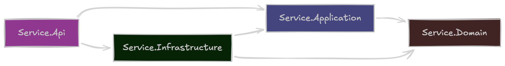
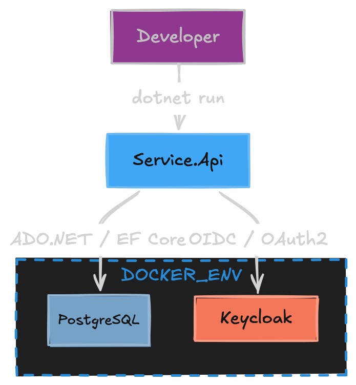

# 🚀 .NET Microservice Starter Template

> A reusable **.NET 10 ASP.NET Core microservice starter** with clean architectural boundaries, PostgreSQL, EF Core, Keycloak, Testcontainers, Docker, and centrally managed CI/CD.

Build new services without rebuilding the foundation every time. 🛠️

The starter provides the plumbing, conventions, infrastructure, testing setup, and CI/CD integration so teams can focus on the actual service.

---

## ✨ What's Included?

| Area                   | Technology                                  |
| ---------------------- | ------------------------------------------- |
| ⚡ Runtime              | .NET 10 / ASP.NET Core                      |
| 🌐 API                 | Minimal APIs                                |
| 🧱 Architecture        | Domain / Application / Infrastructure / API |
| 🗄️ Database           | PostgreSQL                                  |
| 🔄 ORM                 | Entity Framework Core                       |
| 🔐 Authentication      | Keycloak / JWT Bearer                       |
| ✅ Validation           | FluentValidation                            |
| 🗺️ Mapping            | Mapperly                                    |
| 🧪 Testing             | xUnit                                       |
| 📦 Integration Testing | Testcontainers                              |
| 🐳 Containers          | Docker / Docker Compose                     |
| ❤️ Health Checks       | Liveness / Readiness                        |
| 🔍 Security            | CodeQL, Gitleaks, Trivy                     |
| 📜 SBOM                | Centralized CI/CD                           |
| ✍️ Image Signing       | Cosign                                      |
| 🤖 Dependency Updates  | Dependabot                                  |
| 🔁 CI/CD               | Central reusable GitHub Actions workflow    |

---

## 🧪 Example Feature

The starter contains a small neutral `ExampleItem` feature.

It exists only to demonstrate the expected application flow:

```text
HTTP Request
     ↓
Minimal API
     ↓
Application
     ↓
Domain
     ↓
Repository abstraction
     ↓
Infrastructure
     ↓
EF Core
     ↓
PostgreSQL
```

> 💡 `ExampleItem` is intentionally simple and should be replaced with your service-specific domain behavior.

---

# 📋 Prerequisites

Before getting started, install:

* 🟣 **.NET SDK 10.0.300** or a compatible .NET 10 patch selected by `global.json`
* 🐳 **Docker** with Docker Compose
* 🗄️ **dotnet-ef 10.x**

Install or update the EF Core CLI:

```bash
dotnet tool update --global dotnet-ef --version 10.*
```

Verify your installation:

```bash
dotnet --version
docker --version
dotnet ef --version
```

---

# 🏗️ Create a New Service

## Install the template

Install directly from the repository:

```bash
dotnet new install .
```

Then create your service:

```bash
dotnet new wtag-microservice \
  --name CatalogService
```

The generated solution will automatically replace the `Service` template token with your chosen service name.

For example:

```text
Service.Api
```

becomes:

```text
CatalogService.Api
```

The same replacement applies to:

* project names
* namespaces
* solution name
* Docker configuration
* test projects
* CI/CD configuration

---

## 📦 Create a distributable template package

Build the template package:

```bash
dotnet pack Service.Template.csproj --configuration Release
```

Install the generated package:

```bash
dotnet new install \
  bin/Release/Bma.Wtag.Templates.DotnetMicroservice.1.0.0.nupkg
```

Then create a service normally:

```bash
dotnet new wtag-microservice \
  --name CatalogService
```

---

# 🏛️ Architecture

The starter follows clean dependency boundaries while keeping the structure practical for a microservice.

### Dependency direction


`Service.Api` acts as the **composition root**.

It may reference `Service.Infrastructure` for dependency registration:

```csharp
builder.Services.AddApplication();
builder.Services.AddInfrastructure(builder.Configuration);
```

However, API endpoint code should interact with **Application contracts**, not directly with EF Core or infrastructure implementations.

Architecture tests enforce these boundaries automatically. 🛡️

---

## 🧩 Projects

| Project                      | Responsibility                                                               |
| ---------------------------- | ---------------------------------------------------------------------------- |
| 🧠 `Service.Domain`          | Entities, value objects, domain exceptions and domain events                 |
| ⚙️ `Service.Application`     | Use cases, DTOs, validation, mappings and persistence abstractions           |
| 🗄️ `Service.Infrastructure` | EF Core, PostgreSQL, migrations and repository implementations               |
| 🌐 `Service.Api`             | Hosting, endpoints, authentication, health checks and dependency composition |

### Dependency rules

```text
Domain
  ▲
  │
Application
  ▲
  │
Infrastructure

API ──► Application
 │
 └────► Infrastructure
        composition only
```

The following dependencies are intentionally prevented:

```text
❌ Domain → Application
❌ Domain → Infrastructure
❌ Domain → API

❌ Application → Infrastructure
❌ Application → API

❌ Infrastructure → API

❌ API Endpoints → DbContext
```

---

# 🗂️ Project Structure

```text
.
├── src/
│   ├── Service.Api/
│   ├── Service.Application/
│   ├── Service.Domain/
│   └── Service.Infrastructure/
│
├── tests/
│   ├── Service.UnitTests/
│   ├── Service.IntegrationTests/
│   └── Service.ArchitectureTests/
│
├── infra/
│   ├── compose.yml
│   └── keycloak/
│
├── docs/
│   └── images/
│   
├── .github/
│   ├── workflows/
│   └── dependabot.yml
│
├── .template.config/
│   └── template.json
│
├── Directory.Build.props
├── Directory.Packages.props
├── global.json
├── Dockerfile
└── Service.slnx
```

---

# 🧑‍💻 Local Development

The recommended local workflow is:



Start the infrastructure:

```bash
docker compose -f infra/compose.yml up -d postgres keycloak
```

Apply database migrations:

```bash
dotnet ef database update \
  --project src/Service.Infrastructure \
  --startup-project src/Service.Infrastructure
```

Start the API:

```bash
dotnet run --project src/Service.Api
```

The API is available at:

```text
http://localhost:8081
```

Development OpenAPI JSON:

```text
http://localhost:8081/openapi/v1.json
```

---

## 🐳 Run Everything with Docker

Start the complete stack:

```bash
docker compose \
  -f infra/compose.yml \
  --profile app \
  up --build
```

The local stack contains:

```text
Service.Api
PostgreSQL
Keycloak
Keycloak PostgreSQL
```

For local development, the Compose API enables:

```text
Database__ApplyMigrations
```

> ⚠️ Automatic startup migrations are intended for local development only.

In production, migrations should be executed as a controlled deployment step.

---

## 🛑 Stop the Stack

Stop containers while preserving database volumes:

```bash
docker compose -f infra/compose.yml down
```

Remove containers **and** local database volumes:

```bash
docker compose -f infra/compose.yml down --volumes
```

---

# ⚙️ Configuration

ASP.NET Core configuration supports:

* `appsettings.json`
* environment-specific `appsettings` files
* environment variables
* command-line values

Environment variables use double underscores for nested configuration.

For example:

```text
Keycloak:Authority
```

becomes:

```text
Keycloak__Authority
```

### Available Settings

| Setting                         | Environment Variable             | Purpose                                               |
| ------------------------------- | -------------------------------- | ----------------------------------------------------- |
| `ConnectionStrings:Database`    | `ConnectionStrings__Database`    | PostgreSQL connection string                          |
| `Database:ApplyMigrations`      | `Database__ApplyMigrations`      | Apply migrations during startup for local development |
| `Keycloak:Authority`            | `Keycloak__Authority`            | Keycloak realm issuer / OIDC metadata                 |
| `Keycloak:Audience`             | `Keycloak__Audience`             | Required JWT audience                                 |
| `Keycloak:ClientId`             | `Keycloak__ClientId`             | Client used for role mapping                          |
| `Keycloak:RequiredRole`         | `Keycloak__RequiredRole`         | Required role for the example authorization policy    |
| `Keycloak:RequireHttpsMetadata` | `Keycloak__RequireHttpsMetadata` | Require HTTPS metadata outside local development      |

---

## 🔒 Local Environment Files

A safe example is provided:

```text
.env.example
```

Create `.env` only when local overrides are required.

```bash
cp .env.example .env
```

The following are intentionally ignored by Git:

```text
.env
local appsettings
secrets
IDE metadata
logs
build output
test results
coverage output
```

> 🔐 Never commit production credentials or tokens.

---

# 🔐 Keycloak

Local Keycloak is automatically configured through:

```text
infra/keycloak/service-realm.json
```

The included values are **development only**.

| 🔑 Property         | Value          |
| ------------------- | -------------- |
| Realm               | `service`      |
| Client              | `service-api`  |
| User                | `service-user` |
| Password            | `service`      |
| Required Realm Role | `service-user` |

---

## 🎟️ Request a Local Token

```bash
curl --request POST \
  http://localhost:8080/realms/service/protocol/openid-connect/token \
  --header 'Content-Type: application/x-www-form-urlencoded' \
  --data-urlencode 'grant_type=password' \
  --data-urlencode 'client_id=service-api' \
  --data-urlencode 'username=service-user' \
  --data-urlencode 'password=service'
```

Keycloak roles from:

```text
realm_access.roles
```

and:

```text
resource_access[clientId]
```

are mapped into standard ASP.NET Core role claims.

> 🚨 Replace the development realm, users and credentials for real environments.

---

# ❤️ Health Checks

The service exposes three health endpoints:

| Endpoint          | Purpose                                   |
| ----------------- | ----------------------------------------- |
| ❤️ `/health`      | Aggregate health including PostgreSQL     |
| 💓 `/health/live` | Process-level liveness                    |
| ✅ `/health/ready` | Dependency readiness including PostgreSQL |

Health endpoints are anonymous so Docker, Kubernetes, load balancers and other orchestrators can probe the service without requesting an access token.

---

# 🗄️ Database Migrations

## ➕ Create a Migration

```bash
dotnet ef migrations add MigrationName \
  --project src/Service.Infrastructure \
  --startup-project src/Service.Infrastructure \
  --output-dir Persistence/Migrations
```

---

## ⬆️ Apply Migrations

```bash
dotnet ef database update \
  --project src/Service.Infrastructure \
  --startup-project src/Service.Infrastructure
```

---

## ↩️ Remove the Latest Unapplied Migration

```bash
dotnet ef migrations remove \
  --project src/Service.Infrastructure \
  --startup-project src/Service.Infrastructure
```

Override the design-time database connection when necessary with:

```text
ConnectionStrings__Database
```

---

# 🧪 Build, Format & Test

### 📥 Restore

```bash
dotnet restore Service.slnx
```

### 🎨 Verify Formatting

```bash
dotnet format Service.slnx --verify-no-changes
```

### 🔨 Build

```bash
dotnet build \
  Service.slnx \
  --configuration Release \
  --no-restore
```

### ✅ Run Tests

```bash
dotnet test \
  Service.slnx \
  --configuration Release \
  --no-build
```

---

## 🧪 Test Strategy

### ⚡ Unit Tests

`Service.UnitTests`

Covers:

* Domain behavior
* value-object invariants
* Application use cases
* validation
* mapping

---

### 🏛️ Architecture Tests

`Service.ArchitectureTests`

Validates:

* project dependency rules
* namespace placement
* Domain isolation
* Application isolation
* Infrastructure boundaries
* API endpoint restrictions

---

### 🐳 Integration Tests

`Service.IntegrationTests`

Uses disposable:

* PostgreSQL containers
* Keycloak containers

The tests:

1. Start required infrastructure.
2. Apply real EF Core migrations.
3. Start the API with `WebApplicationFactory`.
4. Exercise authentication, persistence and HTTP behavior.
5. Dispose the infrastructure after execution.

No permanently running test infrastructure is required. 🧹

---

# 🐳 Docker

The root `Dockerfile` uses a multi-stage build:

```text
Restore
   ↓
Build
   ↓
Publish
   ↓
ASP.NET Runtime
```

The final image:

* contains only the published application and ASP.NET runtime
* listens on port `8080`
* runs using the image-provided non-root user
* receives runtime configuration through environment variables

---

## 🔨 Build the Image

```bash
docker build \
  --tag service-api:local \
  .
```

---

## ▶️ Run the Image

```bash
docker run \
  --rm \
  --publish 8081:8080 \
  --env ConnectionStrings__Database='Host=host.docker.internal;Database=service;Username=service;Password=service' \
  --env Keycloak__Authority='http://host.docker.internal:8080/realms/service' \
  service-api:local
```

---

# 🔁 CI/CD

The starter deliberately contains a **thin CI workflow**.

Application repositories should not duplicate the organization's centralized pipeline logic.

`.github/workflows/ci.yml` delegates to:

```text
pse-wtag/java-ci-cd-template/.github/workflows/master-dotnet-pipeline.yml@main
```

The starter passes:

```text
dotnet-version
solution-path
configuration
```

with values equivalent to:

```text
.NET:          10.0.x
Solution:      Service.slnx
Configuration: Release
```

---

## 🔄 Pipeline Flow

The centralized workflow is responsible for the complete CI/CD lifecycle.

```text
Build
  ↓
Verify
  ├── 🎨 Formatting
  ├── 🧪 Unit Tests
  ├── 🐳 Integration Tests
  └── 🔐 Security
  ↓
Docker Build
  ↓
Image Scan
  ↓
SBOM
  ↓
GHCR
  ↓
Cosign Sign + Verify
  ↓
Release
  ↓
✅ Build Gate
```

---

# 🛡️ Security

Security tooling is centralized rather than duplicated across every service.

The CI/CD pipeline handles:

| Tool        | Responsibility                                  |
| ----------- | ----------------------------------------------- |
| 🔎 CodeQL   | Static code security analysis                   |
| 🔑 Gitleaks | Secret detection                                |
| 🛡️ Trivy   | Dependency and container vulnerability scanning |
| 📜 SBOM     | Software Bill of Materials generation           |
| ✍️ Cosign   | Container image signing and verification        |

The starter keeps conventional .NET, NuGet, publish and Docker layouts so these tools can discover and inspect the application consistently.

---

# 🤖 Dependabot

Dependabot runs weekly and maintains:

* 📦 NuGet dependencies
* ⚙️ GitHub Actions
* 🐳 Dockerfile base images
* 🧩 Docker Compose images

Dependency updates remain owned by each generated service repository.

---

# 🧹 What Should Be Replaced?

When starting a real service, the following sample functionality is intended to be removed or renamed:

```text
ExampleItem
ExampleName
ExampleItemCreated
ExampleItemRepository
Example endpoints
Example tests
```

Keep the architecture and infrastructure foundation, then introduce your own domain behavior.

---

# 🚀 Quick Start

For the impatient:

```bash
# Install template
dotnet new install .

# Create service
dotnet new wtag-microservice --name CatalogService

# Enter project
cd CatalogService

# Start infrastructure
docker compose -f infra/compose.yml up -d postgres keycloak

# Apply migrations
dotnet ef database update \
  --project src/CatalogService.Infrastructure \
  --startup-project src/CatalogService.Infrastructure

# Run
dotnet run --project src/CatalogService.Api
```

Then visit:

```text
http://localhost:8081
```

🎉 Your new microservice is up and running.

